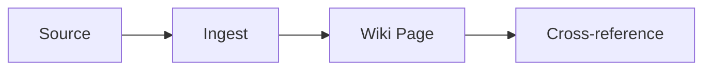

# Vault Visual Standard

Every substantive vault note must be visually engaging — not just text and tables. Notes should captivate attention and be easy to consume at a glance.

> [!key-insight] Core Rule
> Whenever you create or meaningfully update a vault note, enrich it with at least one visual element beyond text and tables. Choose the element that best fits the content type.

---

## Visual Element Playbook

### 1. Images

**When**: Almost any substantive note — games, people, tools, concepts, places, products.

**How**:
- Search the internet for a relevant, high-quality image.
- Embed with `` using a direct image URL (HTTPS only).
- Preferred sources: Wikimedia Commons, official product/game press kits, Unsplash (photos), GitHub repo social previews.
- Size hint: add `| 600` after the URL in Obsidian to constrain width: `![[image.png|600]]` or `` for remote URLs.
- If no clearly appropriate image exists, skip rather than use an irrelevant one.
- For images that must be stored locally rather than linked remotely (curated icon sets, clipped screenshots), see [[Vault Image Folder Standard]] for where the file goes.

**Examples**:
- Game note: key art or screenshot from the official press kit.
- Person/entity: official portrait or profile photo.
- Tool/library: logo from the project's GitHub or website.
- Concept: illustrative diagram or representative photo.

---

### 2. Color Swatches

**When**: Notes about color palettes, design systems, UI themes, brand colors, or any content where color is a primary subject.

**How** — use HTML inline spans (renders in Obsidian's reading view):
```html
<span style="display:inline-block;width:80px;height:28px;background:#1E293B;border-radius:4px;margin-right:6px;vertical-align:middle"></span> `#1E293B` Slate 900
```

For a palette row, string them horizontally:
```html
<span style="background:#F8FAFC" ...></span> <span style="background:#E2E8F0" ...></span> <span style="background:#334155" ...></span>
```

Also acceptable: a Mermaid pie/block diagram when showing proportional color usage.

---

### 3. Callout Blocks

**When**: Every substantive note should have at least one callout highlighting the single most important takeaway, a warning, or a key definition.

**Standard callout types**:

| Type | Use for |
|------|---------|
| `> [!key-insight]` | The most important single idea in the note |
| `> [!tip]` | Practical advice or shortcut |
| `> [!warning]` | Gotcha, caveat, or known pitfall |
| `> [!note]` | Context or background that aids understanding |
| `> [!contradiction]` | Conflicting claims between sources |
| `> [!gap]` | Missing information worth investigating |

Keep callout body to 2-3 sentences. Do not stack more than 2 callouts consecutively.

---

### 4. Diagrams (Mermaid)

**When**: Conceptual relationships, architecture, workflows, timelines, class hierarchies, or any content where structure matters more than prose.

**How**: Use fenced Mermaid blocks. Obsidian renders these natively.



Common diagram types to reach for:
- `graph LR` / `graph TD` — relationships and flow
- `sequenceDiagram` — interaction sequences
- `timeline` — chronological events
- `classDiagram` — entity structures
- `pie` — proportions

---

### 5. Badges / Status Indicators

**When**: Notes about tools, libraries, projects, or games where version, status, or platform is relevant.

**How**: Use Shields.io badge URLs embedded as images.

```markdown


```

Or use Unicode symbols inline for lightweight indicators: ✦ ◆ ▸ ⬡ ★

---

### 6. Section Banners

**When**: Long notes (300+ lines) with multiple major sections.

**How**: Open each major section with a contextual image or a styled horizontal rule. Keep banners narrow — `| 900` max width — and relevant to the section content, not decorative noise.

---

## Exemptions

Do NOT add visuals to:
- Index files (`_index.md`, `index.md`, `Projects.md`, `Resources.md`, etc.)
- Log files (`log.md`, `Journal/`)
- Stub notes with fewer than ~10 lines of content
- Meta/config files (`hot.md`, `overview.md`, `dashboard.md`, frontmatter-only files)
- Template files under `Templates/`

---

## Sourcing Rules

- Always use HTTPS URLs for remote images.
- Never hotlink from sites that prohibit it (check robots.txt / terms if uncertain).
- Prefer stable, long-lived URLs: Wikimedia Commons, GitHub raw assets, official CDNs.
- Unsplash direct-download URLs are stable; use the `?w=800` size parameter to avoid loading oversized originals.
- If sourcing from a game's press kit or a product's media page, note the source in an HTML comment: `<!-- source: https://... -->`.

---

## Applies To

Every vault using this scaffold.

All skills that write vault pages (wiki-ingest, save, autoresearch, canvas) must follow this standard.
